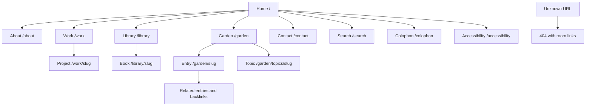
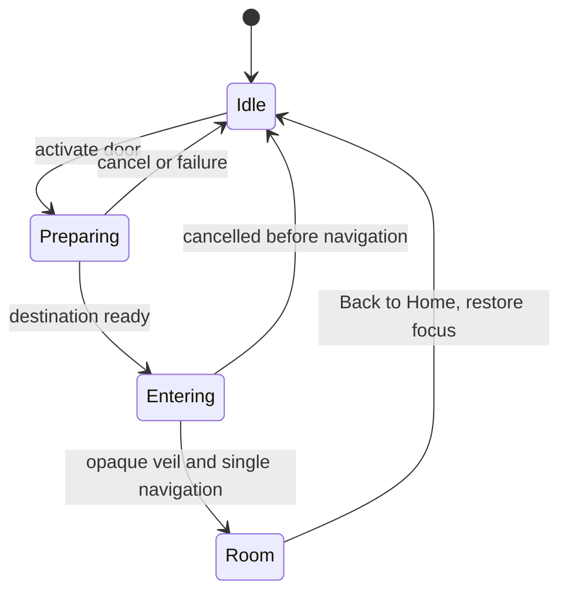

> **November 18 refinement:** About now uses Shantell Sans headings and annotations; Garden uses Bricolage Grotesque headings. Home ambience is gentle wind in trees; Library is an indoor fireplace. Opt-in button/door audio, animated SVG controls, and an animated loading threshold are implemented. See [the refinement specification](DESIGN_PREVIEW.md#interaction-and-type-refinement--november-18-2026), which supersedes the earlier choices below.

# Hassan’s Digital Space — a home with a life inside

Design specification · 17 November 2026 · Proposed direction for implementation

This document reconsiders the whole visual identity, including the doors. It specifies the next design; it does not describe an already implemented website. It takes precedence over the visual recommendations in `DESIGN_RESET.md` where they differ, while preserving those earlier studies as history. The existing Three.js doors are a useful interaction prototype, not a palette or typography constraint.

The intention is a small, inhabited home: afternoon plaster outside, marks of childhood in one room, a clear working desk in another, a winter reading loft, and a summer garden after dark. Materials, objects, and light carry the personality. Reading, navigation, and contact remain straightforward.

## How to use this specification

1. Read the identity, route map, and foundations before building individual pages.
2. Use the [color reference](design-system/PALETTE.md) for **every color in RGB, HSL, and OKLCH**, and its verified contrast pairs. The [machine-readable palette](design-system/palette.json) contains the same values.
3. Apply the shared typography, spacing, control, and motion rules, then the relevant page specification. Page-specific rules override shared aesthetic defaults, not accessibility behavior.
4. Use the [audio source manifest](design-system/AUDIO.md) for sound links, licenses, proposed edits, and playback rules.
5. Finish with the acceptance checklist. Values below are authored design decisions unless explicitly attributed to research; they are not claims that a source prescribes this particular design.

## 1. Decisions and boundaries

**Confirmed by Hassan:** English entrance; four rooms; permission to reconsider all visuals; Home day/night switch; fixed atmosphere for each other room; slight door hover; entry through a door when its destination exists; simpler Garden door; contact through email/social links; both evolving and polished Garden writing; environmental audio only; dislike of harsh pure colors, particularly hard red and white.

**Personal material to preserve:** warm ivory About door with worn wood edges; height marks; Dragon Ball, One Piece, and Detective Conan as the principal childhood references; secondary PS2 and notebook memories. Library shelf candidates: *Crime and Punishment*, *The 7 Habits of Highly Effective Teens*, *Atomic Habits*, *So Good They Can’t Ignore You*, *Deep Work*, and *Steal Like an Artist*. Their reading statuses are not yet known.

**Professional context:** the career audit supplied by Hassan informs project selection. Its claims have not been independently re-audited for this document. Work must distinguish published applications, coursework, prototypes, contributions, and ongoing work. Private projects and private technical findings from the audit are not public page content.

**Design decisions made here:** a shallow plaster entrance with four miniature door bays; scene-led room introductions followed by real HTML content; a stable shared navigation system; four font families plus a code-only companion; no music, gamified biography, mandatory walkthrough, or decorative loading delay.

**Content still needed, without blocking design:** final biography and dates; approved professional headline and availability; current CV; selected project screenshots and case studies; book statuses and original notes; initial Garden entries. Empty states are specified so none of this needs invented content.

## 2. Research translated into choices

| Finding or reference | Design consequence | Limit of the claim |
|---|---|---|
| Albers teaches color through relationships and changing context. [Foundation](https://www.albersfoundation.org/alberses/teaching/interaction-of-color) | Evaluate each accent beside its real surface; warm paper makes blue-green feel cooler, while a little amber gains presence in the night rooms. | No universal promise that a hue produces a particular emotion. The material associations here are an artistic interpretation. |
| OKLCH separates perceptual lightness, chroma, and hue more usefully for palette work than HSL. [CSS Color 4](https://www.w3.org/TR/css-color-4/) | Tune lightness before saturation, preserve subdued chroma, and keep canonical sRGB colors with calculated alternative notations. | OKLCH lightness is not a contrast score. Lit 3D materials require screenshot checks. |
| Text contrast depends on foreground/background luminance. [WCAG contrast](https://www.w3.org/WAI/WCAG22/Understanding/contrast-minimum.html) | Use verified opaque reading surfaces; small brass or ochre details are decorative, not pale paragraph text. | Palette checks alone do not establish page conformance. |
| Type size, measure, leading, and family interact. [Practical Typography](https://practicaltypography.com/summary-of-key-rules.html) | Set prose in a deliberately narrow column; choose family by reading role, then tune its size and spacing. | This specification’s 1.6–1.7 prose leading is our screen-reading choice, not a quotation of Butterick’s recommended range. |
| Rams emphasizes usefulness, honesty, and restraint. [Vitsœ](https://www.vitsoe.com/gb/about/good-design) | Work prioritizes evidence, accurate project status, and direct links; decorative objects support the desk atmosphere without hiding information. | It is not a Braun reproduction or a claim of endorsement. |
| Digital gardens favor connections, ongoing cultivation, and learning in public. [Maggie Appleton](https://maggieappleton.com/garden-history) | Garden supports topic paths, related notes, backlinks, maturity labels, original and revised dates; chronology is secondary. | A graph is optional. A forest illustration alone does not make a digital garden. |

The earlier film/game references guide **storytelling methods**, not literal replicas. About uses clues left by a person, Library uses a tucked-away room above everyday life, and Garden uses small points of light against still water. Avoid borrowing tragedy as decoration or making any room a franchise-themed set.

## 3. The house’s visual grammar

Three motifs repeat: a rectangular threshold, a small handwritten trace, and a warm point of light. The threshold frames doorways, project imagery, book records, and note introductions. Handwritten traces belong to About and occasional personal captions, never to primary controls. Warm light appears as a small reflection or lamp, never a neon outline around everything.

**Materials:** matte plaster, slightly uneven paint, edge-worn wood, lightly frosted glass, cloth book covers, brushed metal, paper, and water. Use broad painted value changes rather than photorealistic grunge. Surfaces should look handled, not dirty. Texture scale must remain believable when objects resize.

**Composition:** one dominant scene or object per page, one dominant title, and one clear next action. Room scenes occupy the opening section; the content beneath them retains the same atmosphere through surfaces and typography. Do not place long prose inside a canvas or project it onto an oblique plane.

**Depth:** nearly frontal camera, slight top and side planes, soft contact shadows. Home doors stand in shallow architectural bays on a solid wall; the wall gives them a shared home and makes the cast shadows credible. No floating islands or giant empty landscape. The phone uses the same door designs in a two-by-two arrangement.

**Taste boundaries:** no pure-white page backgrounds, saturated stop-sign red, black voids, neon gradients, glass cards over every surface, endlessly floating objects, cursor replacement, skill percentage bars, typewriter body text, or automatic camera drift.

## 4. Information architecture



Loading is a transient state, not a destination. Contact, Search, Colophon, and Accessibility use the house’s shared language; they do not require additional doors. A Now section lives in About initially, not a separate route. Technical writing lives in Garden, with related links from Work. A project case study remains in Work. Book reflections belong in Library, with cross-links to related Garden ideas.

All routes must work as deep links. Visiting a project from a recruiter’s email must not redirect through Home. Browser Back restores position and filters; it does not replay the entrance.

## 5. Color system

The complete numerical specification is [PALETTE.md](design-system/PALETTE.md). Token names below refer to those exact values, with no implied opacity. Use semantic aliases in implementation rather than scattering hex strings.

| Place | Background / reading surface | Text / secondary | Accent and main action | Supporting decoration | Reason |
|---|---|---|---|---|---|
| Loading, Home day | plaster / paper | ink / muted | petrol; paper on petrol button | oat, ochre, chalkBlue | Cream plaster holds afternoon light without glaring white; petrol gives the entrance a clear action color. |
| Home night | dusk / duskPanel | moon / mist | firefly; dusk on firefly button | amber, petrol | Cool blue-gray surrounds small warm interior lights; text remains brighter than the scenery. |
| About | paper / plaster | ink / muted | plum; paper on plum button | chalkBlue, ochre, clay | A notebook’s pencil, dusty crayon, and faded sticker colors support childhood without toy-store saturation. |
| Work | desk / paper | ink / muted | petrol; paper on petrol button | oat, chalkBlue | Mineral gray-green and disciplined ink suit evidence and diagrams; warmth keeps the room connected to the house. |
| Library | walnut / tea | tea on walnut; walnut on tea | amber on walnut; walnut on amber button | clay, oat | Dark shelves surround a lit reading page. Use tea for the reading sheet so long reading is not forced onto dark brown. |
| Garden | pond / reed | moon / leaf | firefly; pond on firefly button | moss, amber | Deep water is blue-green, foliage muted, tiny fireflies warm. The contrast creates depth without luminous green text everywhere. |
| Contact, Search, Colophon, Accessibility, 404 | plaster / paper | ink / muted | petrol; paper on petrol button | plum or ochre sparingly | Shared house identity keeps utility pages recognizable and calm. |

Utility pages keep this fixed light atmosphere; Home’s toggle changes **Home only**. Going back to Home restores its saved setting. Inside a book record, the reading sheet is tea, not paper; article text there uses walnut. Garden writing has an optional “Paper reading” setting using paper/ink/moss, preserving a pond-colored header. This is a reading preference, not a second atmospheric theme for every room.

**Accent hierarchy:** approximately 75% quiet surface, 20% structural material/ink, 5% chromatic accent within the initial view. This is a composition heuristic, not a pixel quota. About can reach 10% varied decoration, but text remains the first high-contrast area. Home night light spills occupy less than 8% of the scene.

**Functional colors:** successful action = moss on paper or leaf on pond, plus a check and words. Error = berry on paper, rose on pond/dusk, plus a message and error symbol. Do not encode maturity, selection, errors, or reading status with color alone. Warning uses ink on ochre. Soft does not mean low contrast.

**Focus:** light surfaces use a 3px petrol ring, 3px surface-colored gap; About uses plum; tea uses walnut. Dark surfaces use firefly, Library amber. Always check the complete boundary against its immediate background. Do not lower opacity on text in hover, secondary, or disabled states.

**Shadows and rules:** light UI shadow = ink at 10% alpha, `0 6px 20px`; raised scene shadow = ink at 16%, `0 16px 40px`. Dark UI uses a 1px mist/leaf edge at 25% for decorative separation, not a required control boundary. Required input boundaries use opaque muted on light surfaces or leaf on pond. Decorative separators use ink at 15%. No paragraph text over grain or moving reflections.

**3D color caveat:** these are display/UI colors. Material base colors, lighting, tone mapping, and glass transmission change final pixels. Tune the rendered scene to the swatches visually; keep labels in HTML. Do not claim RGB-equivalent scene materials will look identical under day and night lighting.

## 6. Typography with distinct voices

### Families and reasons

| Family | Role and reason | Source and license |
|---|---|---|
| Fraunces | House titles, About headings, Garden display titles. Its soft forms suit painted wood; its variable softness permits a playful About voice and a sharper, quieter Garden voice within one family. It is a display accent, not the long-form workhorse. | [Designer specimen](https://fraunces.undercase.xyz/), [OFL](https://github.com/undercasetype/Fraunces/blob/master/OFL.txt) |
| Instrument Sans | Shared navigation, controls, captions, Home and About prose. Its restrained shapes keep the scene readable without feeling like default system UI. Use the default glyphs consistently; no random alternates. | [Creator repository and OFL](https://github.com/Instrument/instrument-sans) |
| IBM Plex Sans | Work headings, body, labels, and case studies. A designed technical voice with useful UI forms, allowing the desk to feel precise without making all text monospaced. | [IBM repository and OFL](https://github.com/IBM/plex) |
| Literata | Library headings and reading; Garden article body. Developed for digital reading with optical-size support, so the font choice follows the actual activity. Library uses upright book typography; Garden combines it with restrained Fraunces headings. | [TypeTogether specimen](https://www.type-together.com/demos/literata/literata.html), [OFL](https://github.com/googlefonts/literata/blob/main/OFL.txt) |
| IBM Plex Mono | Code blocks only, loaded when an article actually contains code. The technical distinction is useful there, not on every project label. | [IBM source](https://github.com/IBM/plex) |

Keep actual handwritten crayon annotations as a small set of original SVG marks, each with an HTML equivalent when meaningful. This avoids an extra handwriting font and prevents decorative scribble becoming the reading voice. Stickers are marginalia, not navigation labels.

### Exact type roles

Sizes are CSS px at a 16px root, expressed as rem in implementation. Respect browser font-size preferences. Desktop applies from 1024px; mobile values apply below 640px; interpolate between. Line-height is unitless; tracking is em.

| Token / role | Family | Mobile → desktop size | Weight | Line-height | Tracking | Measure |
|---|---|---:|---:|---:|---:|---|
| home-title | Fraunces | 38 → 64 | 600 | 1.08 | -0.025 | 16ch; at most 2 lines |
| room-title | room heading family | 36 → 52 | 600 | 1.12 | -0.02 | 20ch |
| work-title | Plex Sans | 34 → 48 | 500 | 1.16 | -0.025 | 23ch |
| article-title | Library Literata; Garden Fraunces; Work Plex Sans | 32 → 44 | 600 | 1.18 | -0.015 | 25ch |
| section-title | room heading family | 26 → 32 | 600 | 1.25 | -0.01 | 28ch |
| card-title | room heading family | 21 → 24 | 600 | 1.3 | -0.01 | natural wrap |
| lead | room body family | 19 → 22 | 400 | 1.55 | 0 | 48ch |
| body | Instrument; Plex in Work | 17 → 18 | 400 | 1.65 | 0 | 62ch |
| reading | Literata | 18 → 20 | 400 | 1.7 | 0 | 62ch; max 70ch |
| control | Instrument; Plex in Work | 16 → 16 | 500 | 1.25 | 0 | never truncate action |
| door-label | Instrument; hand-drawn About art additional | 18 → 20 | 600 | 1.3 | 0 | full destination name |
| meta / caption | Instrument; Plex in Work | 14 → 14 | 400 | 1.5 | 0.01 | 60ch |
| eyebrow | shared UI family | 12 → 12 | 600 | 1.4 | 0.08 | short uppercase only |
| code | Plex Mono | 14 → 15 | 400 | 1.6 | 0 | horizontal overflow inside block |
| pull-quote | Literata italic | 24 → 30 | 400 | 1.45 | -0.01 | 35ch |

Fraunces settings: Home `SOFT 50, WONK 1`; About `SOFT 100, WONK 1`; Garden `SOFT 0, WONK 0`. Use `font-optical-sizing:auto`; do not animate font axes. Library uses Literata throughout its headings and prose, with Instrument controls. All non-Work utility pages use Fraunces headings and Instrument body. Italic is for brief emphasis and quotations, not full articles. Body links are underlined with a 3px offset, 1px thickness; hover increases thickness to 2px without shifting layout.

Fallbacks: Fraunces/Literata → Georgia, serif; Instrument/Plex Sans → system-ui, sans-serif; Plex Mono → ui-monospace, monospace. Use `font-display:swap`, self-host WOFF2, keep OFL notices, and measure fallback metrics before choosing `size-adjust` values. No invented metric overrides. Load only route-used families and weights; Home needs Instrument plus Fraunces roman, not all five. Start with a 180KB compressed font budget per route and measure actual files before acceptance. Italics and code fonts load only when used.

Typography QA uses real long titles, apostrophes, numbers, book titles, and Hassan’s actual paragraphs. Check 200% zoom and user spacing overrides, not just a specimen word. [WCAG text-spacing guidance](https://www.w3.org/WAI/WCAG22/Understanding/text-spacing.html) requires content to survive overrides; it does not mandate the default leading in this table.

## 7. Layout, spacing, decoration, and icons

**Spacing tokens:** 4, 8, 12, 16, 24, 32, 48, 64, 96px, mapped to 0.25–6rem. 4px is for small internal alignment; 8–12px for icon/label and related controls; 16–24px for card padding and paragraphs; 32–48px for related sections; 64–96px between major chapters. Do not apply a giant 96px gap between every small piece of content.

| Layout property | Phone <640 | Tablet 640–1023 | Desktop ≥1024 |
|---|---:|---:|---:|
| Page gutter | 20px; 16px at ≤360 | 32px | 48px |
| Content max width | available | available | 1200px centered |
| Grid | 4 columns / 16px gap | 8 / 24px | 12 / 24px |
| Header min height | 64px | 72px | 80px |
| Major section gap | 48px | 64px | 96px |
| Card padding | 20px | 24px | 32px |
| Reading width | available | 62ch | 62ch |
| Scene intro height | content-led 240–360px | 360–480px | 420–560px |

Home is exempt from the intro-height row: its four doors need about 500–640px on phone and 360–460px on desktop, plus title/navigation. Allow scrolling on short screens. Never shrink labels to force everything into one viewport. At text zoom or an extremely narrow viewport, the two-column phone grid can become one column when two 140px door hit areas no longer fit.

**Edges:** normal controls 8px radius; reading sheets 4px; object labels 6px; chips 999px only when a filter genuinely benefits from a pill shape. About paper can rotate ±1.5° as a background illustration, but the text layer remains upright. Work uses 4px corners and 1px rules. Garden uses 12px panels with rectangular reading flow, not blobs around paragraphs.

**Texture:** static plaster/paper grain at 2–3% visual contrast, masked away from text and input fields. Wood uses 3–5 broad grain lines per plank, not noise at every pixel. Limit drawn imperfections to 2–3 per object. Use screen-space inspection to avoid moiré. Reflection highlights occupy narrow strips, no mirror chrome.

**Icon system:** original SVG line icons, 24×24 viewBox, 1.75px strokes, round caps and joins; visible at 20–24px inside ≥44×44px targets. Home = simple doorway, About = notebook, Work = desk lamp, Library = open book, Garden = two-leaf sprig, Contact = envelope, Search = magnifier, sound = speaker with explicit on/off label, motion = still/moving-circle symbol plus text. The same geometry appears in every room; only color changes. Decorative doodles may be irregular, functional icons may not. Social links use readable platform names; brand marks are optional, not a dependency. Icons supplement text; `aria-hidden` for duplicates, accessible names for icon-only controls.

## 8. Shared navigation and controls

Desktop header: house wordmark/home link at left; Rooms, Work, Contact at right; appearance on Home only; sound and a Preferences button. Work stays directly reachable. On mobile: Home, Rooms, Preferences in the header, Contact inside the room menu; Home also exposes a “Here for my work?” link below its invitation. All room menus contain the four destinations and Contact. Current room has a text marker and `aria-current`.

Room menu is a button opening a nonmodal navigation disclosure, not an ARIA application menu. Escape closes it; selecting a link closes it; focus stays intelligible. Preferences is a modal dialog: labelled, focus contained, Escape/close restores the invoker, background inert. Preferences: Sound off/on, volume, Motion system/reduced, animated scenery pause/resume, and Garden paper reading. There is always an accessible skip-to-content link.

### Control state specification

All transitions below use 140ms `cubic-bezier(.2,.8,.2,1)` unless another duration is specified. Normal targets are at least 44px high with 20px horizontal padding and 8px icon gap; this is our comfortable design target, above WCAG’s minimum target rule. [WCAG target sizes](https://www.w3.org/WAI/WCAG22/Understanding/target-size-minimum.html)

| Component | Rest | Hover / focus | Press / click | Loading, disabled, feedback |
|---|---|---|---|---|
| Primary action | Room action fill and contrasting text from color map | 2px inset contrasting keyline; focus adds external focus ring; no arbitrary lightening | Translate down 1px for press, execute on activation | Preserve width; “Opening…” or actual verb; `aria-busy`; no decorative fake wait |
| Secondary action | Transparent, 1px current text-color border | 2px inset line; preserve fill and text pair | 1px down, then action | Disabled keeps readable text, dashed border and unavailable explanation; no hover movement |
| Inline link | Underlined, same verified ink/accent | 2px underline; focus ring with offset | Native navigation; support modified click | Visited may retain underline and same color; do not imply broken link by fading it |
| Filter chip | Outline, text label | Room focus ring; stronger outline | Toggle filled selection plus check, `aria-pressed` | Announce result count politely; zero results offers Clear filters |
| Icon button | Visible icon plus name where space permits | Ring and background-independent border | No spin or bounce | Tooltip on hover/focus if unlabeled visually; never tooltip-only accessible name |
| Search input | Opaque room reading surface, 1px functional border, persistent label | 2px border and focus ring | Caret; Enter submits shareable URL query | Result count and empty state; clear button labelled; no ghost placeholder as only label |
| Copy email/link | Secondary action | Same secondary behavior | Copy via clipboard after explicit click | Success “Copied” + check for 2s, polite announcement; failure shows selectable address, “Select and copy” |
| Disclosure | Label and chevron | Underline + ring | Enter/Space expands; `aria-expanded`; chevron rotates 90° | Content stays in document order; no inaccessible height clipping |

Each primary action is either an anchor for a destination or a button for a local action. Do not nest buttons within a clickable card. Cards have a clear title link; extra live/source links remain separate. Loading/disabled is reserved for real unavailable actions, not ordinary anchors. Dark primary actions use dark text on firefly/amber, so their state keyline must also be dark.

## 9. Motion and door entry

| Motion token | Duration | Easing | Use |
|---|---:|---|---|
| feedback | 140ms | cubic-bezier(.2,.8,.2,1) | Controls, underline, focus-related visual changes |
| object | 220ms | cubic-bezier(.2,.8,.2,1) | Door handle, book selection, About object |
| reveal | 280ms | cubic-bezier(.22,1,.36,1) | Local panel fade/8px rise |
| route | 180ms | ease-out | Standard page crossfade; no camera |
| enter | 1100ms total | cubic-bezier(.65,0,.35,1) for travel | Deliberately activating a Home door |
| atmosphere | 600ms | ease-in-out | Home day/night lighting blend |

Home hover: handle turns at most 4°, door face shifts no more than 2 screen pixels, light line brightens slightly over 220ms; label underlines. No door opens on hover, no sound on hover, no tilt following the cursor. Keyboard focus gets the same label/light cue plus a real HTML ring. Touch has a small pressed cue, then enters on the first tap.

**Entry timeline:** 0–180ms handle press; 120–650ms panel swings inward to approximately 65°; 280–850ms camera advances toward the selected threshold without roll; 700–920ms doorway-toned veil becomes opaque; at opacity 1, destination content replaces Home; 920–1100ms veil fades away. Match the veil to the destination’s background, avoiding a white flash. The room appears behind the door as a simple light/material glimpse, not a duplicate fully rendered page.

Destination HTML/data should be ready before travel begins. If preparation takes >200ms, show “Opening Library…” beside the selected label with Cancel; other navigation remains available. Do not lock the visitor behind a forever-opaque veil. After a failed preparation, retain Home and offer Retry or direct text navigation. If the scene fails, navigate without the animation. Navigation triggers once, even on repeated activation; abort on Back/unmount/new destination.



Once rooms exist, opening a door means entering. Open/close peeks remain only in the component demonstration. Escape cancels a pending transition before navigation; after navigation it does not unexpectedly leave the page. Set focus to the destination h1 and announce its title; returning Home restores the activated door when feasible. Direct links and browser history use the 180ms route treatment, not a simulated doorway.

Reduced motion removes travel, rotation, object displacement, parallax, drifting leaves, water movement, and firefly animation. Use at most a 100ms opacity change. Scenery can also be paused independently. Supporting reduced motion follows [W3C animation guidance](https://www.w3.org/WAI/WCAG22/Understanding/animation-from-interactions.html); it does not mean hiding content. No scroll-jacking or scroll-dependent text reveals.

## 10. Loading / arrival state

**Look:** plaster background, a small original doorway line drawing in petrol, Fraunces section-title, Instrument metadata. Copy: “Entering the home” and, if genuinely waiting, “Preparing the entrance.” A 120px doorway illustration sits 24px above the title; title-to-status gap 12px; group width max 360px. Use roomy 24px side padding on phone.

```text
                  ┌──────┐
                  │   ·  │   static doorway drawing
                  └──────┘
               Entering the home
             Preparing the entrance

          Continue without the 3D scene →
```

Show only when loading actually needs it; no minimum display duration. Do not generate a fictitious 0–100% counter. Real known asset progress may use a labelled progressbar; unknown work uses text and a small opacity pulse, disabled under reduced motion. The HTML title and ordinary links should be available immediately. Offer the scene-free entrance at once; after 8 seconds, add “The entrance is taking longer than expected” and Retry. Scene-free means four illustrated/static door links with identical names, not a broken-page warning. No audio during loading. Direct visits to room pages show only their local skeleton if needed, not this Home arrival treatment.

## 11. Home — four thresholds on afternoon plaster

**Purpose:** choose a part of Hassan’s life; quietly offer the faster professional path.

The desktop wall is solid plaster, with one baseboard and a shallow floor strip. Soft light arrives from upper left. Four bays share a baseline and approximately equal visual weight; the Library’s darker bookcase is narrower internally to compensate. Camera is nearly frontal, about 5° above the handles, showing a little frame depth. No dramatic wide-angle distortion.

```text
 Hassan’s Digital Space                  Rooms  Work  Contact   Day  Sound off

                    Hassan’s digital space
                       Choose a door to enter
                    Here for my work? View projects →

     ┌───────────┐    ┌───────────┐    ┌───────────┐    ┌───────────┐
     │ marks +   │    │ frosted   │    │ books     │    │ clear     │
     │ stickers  │    │ glass     │    │ + walnut  │    │ glass     │
     │ ivory     │    │ office    │    │ shelves   │    │ one vine  │
     └───────────┘    └───────────┘    └───────────┘    └───────────┘
         About            Work            Library          Garden
       My story        Things I build    My bookshelf     Growing ideas
 ─────────────────────────── shallow floor ───────────────────────────────
                       Colophon · Accessibility
```

Desktop scene maximum 1120px, four equal slots with 32px gaps; doors occupy roughly 190×300px within their slots, labels separated by 16px. Title begins 48px below header; subtitle gap 16px; scene gap 40px. These are composition targets; preserve proportions at intermediate widths.

```text
 Home                              Rooms   Preferences
          Hassan’s digital space
            Choose a door to enter
               View projects →

       [ About door ]  [ Work door ]
           About          Work
       [ Library    ]  [ Garden    ]
          Library        Garden

              Day / Night     Sound off
               Contact · Colophon
```

Phone bays use 16px column gap, 32px row gap, minimum door-art height 190px. Captions can omit the descriptive line; labels never disappear. Door art and label are one accessible navigation target, without duplicate tab stops. The DOM controls need real routes; the canvas is supplementary.

**Door art direction:**

| Door | Build / details | Remove or limit | Interior glimpse |
|---|---|---|---|
| About | Worn paper/plaster paint, walnut exposed at corners, 5–7 height ticks on left jamb; three clustered childhood decals near eye level, crayon “About” art plus HTML label | No invented dates/ages; no wall of unrelated franchise logos | Plum notebook edge, warm floor patch, pinboard silhouette |
| Work | Walnut lower panel, large frosted pane, thin brushed-metal handle, small aligned nameplate | No corporate tower, neon terminal, or giant technology logos | Quiet desk line and shaded lamp |
| Library | Walnut bookcase, 3 substantial shelves, irregular book widths, discreet recessed handle | 12–16 visible books maximum; no tiny readable full titles required on phone | Amber shelf edge and window silhouette |
| Garden | Sage-like moss/petrol frame, 4 broad glass panes, one vine on upper-right jamb, one small pot | No dense foliage arch, many trunks, floating leaves, or hidden handle | Pond and reed silhouettes with 3 warm light points |

Existing nostalgia drawings should be reviewed as fan-art references before production; original personal doodles are the preferred asset treatment. Do not use copied anime frames, promotional posters, or franchise sound clips as default assets.

**Night:** wall becomes dusk, text moon, secondary mist. Door bodies remain identifiable; add amber spill under About/Library, cool moon reflection on Garden glass, restrained desk light behind Work. Do not turn all four frames into glowing borders. Toggle has explicit Day/Night labels and persists locally; initial Home mode follows system preference if no saved choice. Day/night changes neither route nor room atmosphere.

**Audio:** optional breeze on Home day/night, lower in night mode; no fabricated “sun” sound. Entry itself stays silent in the initial sound plan. **Failure:** static door images and labels replace WebGL; all navigation remains available.

## 12. About — the room that remembers

**Atmosphere:** late-afternoon paper, dusty plum, scattered objects around a clear notebook. Playful asymmetry is concentrated at the edges. Diary-like captions and environmental storytelling communicate curiosity without making the visitor solve a puzzle to learn who Hassan is.

```text
 Home / About                                          Rooms · Preferences
  [height marks]       A life still being figured out.      [small pinboard]
                       Short personal introduction

  [3 meaningful objects]       ┌── open notebook ──────────────────────┐
  Dragon Ball / straw hat      │ Childhood                             │
  detective glasses motif     │ Actual biography, in Hassan’s voice   │
  [Read my story ↓]            │ Learning / making / changing direction│
                              └───────────────────────────────────────┘
  Now: what occupies me         Things I return to        Say hello →
```

Headline above is proposed copy, not a biography claim. Use About room-title and body roles, plum accents. Hero: 5/12 columns for meaningful objects, 7/12 for introduction; 48px gap. Below: vertical chronological chapters, each with a 32px section heading gap and 24px paragraph/object gap. Use real dates only. Do not present study time as an animated scoreboard.

Phone: title → introduction → one 240px-high object grouping → “Read my story” anchor → stacked chapters → Now → Contact. All personal information exists in the normal reading order. Optional object interaction opens a short local note below the object with an explicit close control; its title is also a standard link/disclosure. Hover raises an object 2px and rotates at most 1° over 220ms. Selecting a sticker does not launch a game or sound.

The three principal references represent wonder, adventure, and deduction as **our proposed narrative reading**, not claims about Hassan until he writes the captions. PS2 can be one secondary shelf prop. No fictional childhood addresses, dates, or memories. Notes use Instrument body; drawn annotations are short, supplementary, with equivalent text.

Primary action: Read my story, using plum/paper. Secondary: Work and Contact. Audio: optional very quiet breeze from a window; no cartoon dialogue or music. Empty biography section: editorial placeholder in development only; public launch shows a short approved introduction and omits empty chapters.

## 13. Work — a well-used engineering desk

**Atmosphere:** clear mineral desk color, daylight, petrol accents, precise Plex typography. The opening desk/lamp illustration occupies no more than one quarter of the first desktop view. Evidence is the scene’s main content.

Proposed headline for Hassan to approve: **“Software developer building thoughtful interfaces and exploring the systems beneath them.”** Supporting sentence can mention TypeScript/React and systems learning after confirming wording. Do not assert employment history, seniority, availability, or completed degrees from the supplied audit.

```text
 Home / Work                                      Projects  CV  Contact
 Software developer building thoughtful interfaces...     [desk lamp]
 Short positioning statement
 [View selected work ↓]  [CV]  [Contact]

 Selected work                       Application / Coursework / Contribution
 ┌────────────────────┐  Memory Sequence         Published application
 │ Actual screenshot  │  What it does + Hassan’s contribution
 └────────────────────┘  [Case study] [Live app] [Source]
 ┌────────────────────┐  Gitlet                  Coursework
 │ Architecture view  │  Persistent state, branches, and merge decisions
 └────────────────────┘  [Case study] [Source]
 ...Assembly server...   ...TypeScript application when documented...

 Collaboration             Skills demonstrated through projects
 Writing about engineering                      More experiments →
```

Opening max 48ch lead; section starts 48px after actions. Project rows use 5/12 image, 7/12 text, 32px gap, 48px vertical separation, with a fine horizontal rule. Four strong projects are better than a repository grid. On phone: title and actions first, screenshot above description; full-width rows; live/source links wrap with 12px gap. No horizontal project carousel.

**Curated starting selection from the supplied audit:** Memory Sequence (published interactive frontend), Gitlet (coursework/design complexity), assembly HTTP server (educational systems), and one documented TypeScript application after its status is checked. A compact contribution row may link to Bro PR #12. Brutal Tomato can appear under visual prototypes, explicitly static. Avoid 59-repository counters, star ratings, skill percentages, and unverified performance/coverage statistics.

Each summary includes title, one-line problem, individual contribution, 2–4 relevant technologies, status, and links that actually exist. Source/live are independent actions, not tiny icons. Skills appear as “Demonstrated in…” links, grouped Interfaces, Systems, Data & APIs, Testing & tools. No implied professional mastery of every studied technology.

Filter is optional until there are more than six entries; do not build an elaborate empty filter system. If present, labels distinguish type, not quality. Audio: silence, including when the global sound preference is on. Entry fades the previous ambience out. This room respects a recruiter opening it at work.

### Project detail — `/work/:slug`

```text
 Work / Project title                         [Source] [Live, if available]
 Project title
 Problem · Status · Role · Dates, if known
 [one honest screenshot or architectural illustration]
 Summary / what I built
 ├─ Problem and constraints
 ├─ Decisions and tradeoffs           [desktop section links]
 ├─ One difficult technical problem
 ├─ Validation actually performed
 └─ Limitations and next steps
 Related project                              Contact →
```

Plex article-title and body; max 68ch prose, 1040px wide figures; desktop 200px table of contents beside article, phone collapsible “On this page” above it. Code uses Plex Mono on paper, ink text, petrol/berry/chalkBlue syntax with textual meaning independent of color. Copy-code button follows shared copy behavior. Diagrams have descriptions. Screenshots can open an accessible zoom dialog; keyboard closes and restores focus. Do not animate charts into existence or claim test success merely because tests exist. Missing demo: omit Live, explain if relevant, never a disabled mystery icon.

## 14. Library — the lamp-lit loft

**Atmosphere:** walnut shelves, amber lamp, a cool winter window in the far background, a tea-colored reading page. The loft reference becomes a private reading nook; avoid a literal cartoon recreation. A chair and mug are supporting props, never requirements to access notes.

```text
 Home / Library                                      List view · Preferences
                         A shelf of things I return to
                         Books, notes, and unfinished reading
    [winter window]   [Reading] [Read] [Want to read]        [lamp]
  ─────────── dimensional shelf: readable book-title links ─────────────
     [book] [book] [book]       [book] [book]
  ──────────────────────────────────────────────────────────────────────
  Selected book: title, author, status         [Open my notes →]
  Recently added reflections                  Browse all books
```

Library room-title is Literata 600; body reading uses Literata; controls Instrument. Reading status tabs are labelled filter buttons, with text/check selection, not an imitation tab widget unless actual tab semantics are implemented. Desktop shelf has up to six books across a 1040px area; 24px spacing; book art is supported by horizontal readable titles below or a list. No requirement to read rotated spine text. Phone shows two covers per row with horizontal titles, each ≥140px wide; list-view control remains visible.

Hover/focus pulls a book forward by a maximum 6 screen pixels over 220ms; focus also outlines its HTML link. Clicking opens its route, not an uncloseable 3D book. Do not play page-turn effects for hovering. Lamp flicker is absent; winter window is static. A 3D shelf must share data with the list so books do not disappear from assistive technology.

The six supplied titles are initial catalog candidates. Until Hassan supplies statuses, they should be “On my shelf” in drafts, not falsely marked Read. Public reading filters only include known status data. No fabricated reviews, quotes, reading percentages, or completion dates. Covers can use original typographic cloth-cover art with real title/author; source publisher artwork only with appropriate permission/use review.

Audio: optional light rain, softened to suggest a window; no fireplace layer unless it becomes an actual scene object and a separately sourced asset. Empty filter: “Nothing on this shelf yet” with All books, not recommendations presented as owned books.

### Book record — `/library/:slug`

```text
 Library / Book title
 [cover]  Title — Author
          Reading status, dates only when known
          My short impression
 ┌──────────── tea-colored reading sheet ──────────────────┐
 │ Why I picked it up                                     │
 │ Notes in my own words                                  │
 │ What I disagree with / what stayed with me              │
 │ Related Garden notes                                   │
 └────────────────────────────────────────────────────────┘
 Previous / Next book                         Back to shelf
```

Walnut surrounds a tea sheet, 48px desktop/24px mobile padding; Literata article-title and reading roles; 62ch prose. Cover is 200px wide desktop, 120px phone beside a wrapping title where space allows. Use actual short attributed quotations only when supplied; never fill it with copied chapters. Links walnut with underline; filled buttons amber with walnut text. Returning restores shelf filter/position. No reading notes yet: honest “I haven’t added my notes yet” and related shelf navigation.

## 15. Garden — beside the pond, after dusk

**Atmosphere:** still blue-green water, muted reeds, a few warm fireflies, open sky at the top. Darkness is gentle and colored. The garden is an information space for things that change, not a simulated forest to navigate with a mouse.

```text
 Home / Garden                                    Search notes · Preferences
 Things I’m growing
 Thoughts, recipes, films, games, and connections between them.
 [pond strip with 5–8 small warm lights; no text over water]

 Paths through the garden
 [Learning] [Making] [Everyday life] [Recipes] [Films & games]

 Recently tended                  A path worth following
 Seedling · Note title             Note → related book → reflection
 Growing  · Note title
 Evergreen · Essay title           [Browse everything →]
```

Fraunces sharp room-title; Literata reading body; Instrument controls and metadata. Header pond, content panels reed; no translucency behind text. Two desktop columns 7/12 and 5/12, gap 48px; single column phone. Scene strip 200px desktop/140px phone and sits outside prose. Topics wrap. Notes use flat rows with 24px vertical padding and leaf-toned decorative dividers; avoid dozens of floating glowing cards.

Maturity labels: **Seedling** = question or incomplete idea; **Growing** = developed but revisable; **Evergreen** = relatively settled, still editable. Pair word and small line icon (seed, sprout, branch); do not imply factual correctness. Content types (note, essay, recipe, film, game) are separate from maturity. An unfinished essay can still be Growing. Dates say “Planted” and “Last tended,” but display ordinary dates for clarity. Topic associations and backlinks provide the actual garden behavior.

Hover on a note underlines its title; a nearby decorative sprig may shift 1px, never move the target. Fireflies: 5–8 maximum, ≤12px travel over 8–14 seconds, soft opacity variation with no flashes; pause when hidden, reading, or motion-reduced. Water moves only in the scene strip, ≤2px apparent displacement, slow 12-second cycles. No particle trail following the cursor. Audio: optional stream and much quieter breeze, both controllable together; leaf rustle reserved for explicit Garden-door entry only if audio is already enabled.

First version can launch with a few authentic notes; show a clearly labelled list, no fake connected graph. If empty, “This patch is still being planted” and links to Library/About. A graph can be a later optional view only if it helps navigate a real set of connections.

### Garden entry — `/garden/:slug`

```text
 Garden / Topic
 Maturity · Type              Planted date · Last tended date
 Title of this thought
 Short summary / unresolved question
 ────────────────────────────────
 Article in one readable column          [On this page, if long]
 ...
 What changed / open questions
 Connected ideas · Mentioned in
 [Copy link]                              Back to Garden
```

Garden article-title; Literata 18→20px reading; 62ch. Use pond background with an opaque reed article area and 32px/24px padding, or the user-selected paper reading surface. No animated water behind paragraphs. Short seedlings do not require a table of contents. Backlinks are generated from actual references, not invented editorial associations. Copy link shares the canonical entry URL. Revision summary is a small disclosure, not a feed of every typo.

**Recipe variant:** same shell; add source/origin attribution, servings, preparation/cooking time only if known, ingredients with checkboxes, and ordered steps. Checkboxes are session-local aids with a labelled Reset; print uses a clean paper layout. A serving scaler is deferred until quantities have structured units; do not multiply informal measurements blindly. “Jump to ingredients” is the primary local action. No invented nutritional or medical claims.

**Film/game variant:** title, creator/year if known, medium, personal reflection, themes, related entries. Spoilers sit behind an explicit “Show spoilers” disclosure, collapsed initially. No numeric rating by default; written response is more personal. Use original symbolic artwork or rights-cleared images, not a mandatory scraped poster. There is no automatic trailer/game audio.

**Essay variant:** add summary, estimated reading time calculated from actual content, optional sections, references, and revision date. Technical essays can use the shared code/diagram treatment without turning the whole room into Work.

### Topic index — `/garden/topics/:slug`

Title → 2–3 sentence introduction → curated starting point → linked entry list → related topics. Same Garden palette and type; 800px max list width, 24px row padding. Maturity/type filters update a shareable query string. Phone has stacked filters and full-width rows. No category counts unless calculated. Unknown topic gets the real 404; known empty topic gets an honest empty state.

## 16. Contact — a note by the hallway table

**Look:** plaster, paper, ink, petrol; one small envelope drawing with a plum stamp-like accent. Fraunces room-title, Instrument body/control. Heading proposal: “Leave a note.” Supporting text should invite conversation without promising response time or availability.

```text
 Home / Contact
 Leave a note.                               [small envelope]
 A short personal invitation

 officialhassansmail@gmail.com
 [Open email app]  [Copy email]

 GitHub →       LinkedIn →       X →       Instagram →
                                 Back to the house
```

Max content width 720px; email card padding 32px desktop/24px phone; 24px gap to social links. Address wraps safely at narrow widths and remains selectable. Mobile actions stack when necessary. `mailto:` opens the email client; it must not display “Message sent.” Copy success uses “Email copied”; failure leaves the address available. Social links are named anchors with external-destination indication; no surprise new tab unless clearly announced.

Existing repository contacts: [GitHub](https://github.com/Hshs-dev), [LinkedIn](https://linkedin.com/in/hshsdev/), [X](https://x.com/Hshs_dev), [Instagram](https://www.instagram.com/hs.2k3/), and the email above. These were read from the current application, not revalidated as live profiles in this research. Confirm them before release. No form, captcha, submission-success page, newsletter, or contact backend. Audio: silence.

## 17. Search — the house index

`/search?q=...` is a normal shareable page, reachable from room navigation and Garden. No keyboard shortcut is required to discover it. Shared light utility palette, Fraunces article-title, Instrument body.

```text
 Home / Search
 Find something in the house
 Search [________________________] [Search]
 All / Work / Books / Garden
 6 results for “systems”
 Work · Project title — useful matching excerpt
 Garden · Note title — useful matching excerpt
 Library · Book title — author
```

Max 800px, input ≥48px high, 24px row padding. Phone places submit below only if it cannot fit. Results title links are 21px/600; excerpt 17px/1.65; path 14px. Match highlight = ink on ochre, never hue alone. Search only public content, not drafts/private audit context. Empty query shows category links; no matches shows query and Clear filters; index-loading failure offers room links. Search may be client-side initially, but its state must survive refresh. Audio: silence; ordinary route transition only.

## 18. 404 and failure states

404 is a utility page with a small, visibly unfinished doorway outline, not a frightening locked room. Plaster background, Fraunces room-title, Instrument body, petrol action. Copy: **“This door doesn’t lead anywhere yet.”** Then plain “The page could not be found.” Visible Home, Work, Library, Garden, and Contact links; browser Back is secondary and Home remains available if there is no useful history.

```text
                         [small missing doorway]
                     This door doesn’t lead anywhere yet.
                         The page could not be found.
                  [Back to the house]   [Browse the garden]
                            Work · Library · Contact
```

Max 560px text, 32px illustration-to-title gap, 24px actions gap. Static illustration; no comic error sound, countdown, or forced redirect. Unknown routes should return a proper 404 status where the deployment architecture supports it; do not visually disguise errors as successful content.

Distinguish this from a temporary route load failure: “This room couldn’t load” with Retry and Home, retaining any available content. WebGL failure is a scene fallback, not a site error. Offline state says content is unavailable only when a request fails; do not imply offline caching/PWA support that is not implemented. Missing cover/screenshot gets a designed typographic placeholder. No endless skeletons.

## 19. Colophon and accessibility pages

**Colophon `/colophon`:** “How this home was made.” Shared utility palette; Fraunces article-title; Instrument body at 62ch. Sections: design intent, software used, font credits and OFL links, illustration authorship, sound title/creator/source/license/edit credits, and a simple last-updated date. Use a two-column definition list on desktop and stacked entries on phone. External asset links follow standard underline states. Keep the credits human-readable and tied to the assets actually shipped, not every research candidate. Audio: silence.

**Accessibility `/accessibility`:** heading, short description of available navigation alternatives, reduced motion, sound controls, text reading mode, known limitations, and email feedback link. Same typography/palette, 62ch measure, 32px section gaps. Provide direct Preferences button and room links. Do not claim WCAG conformance until an actual audit. Explain that scene-free navigation carries the same content. Audio: silence. These pages need no 3D scene.

**Privacy:** initially a short Colophon section describing actual local preference storage and any real analytics/hosting behavior after checking implementation. Add `/privacy` only if the final integrations warrant a separate statement. Do not invent tracking, analytics, or a consent banner for features that do not exist.

## 20. Audio system

See [AUDIO.md](design-system/AUDIO.md) for verified sources and the exact proposed mix. Sound is off by default. A user explicitly enables it; remembered preference does not bypass browser activation rules. No automatic sound on loader, hover, error, success, or contact. Environmental sound follows room atmosphere; Work and utility pages remain silent. A persistent mute control is always reachable.

This is a quiet home, not a soundtrack. Silence is an intentional state, not an unfinished asset. Content and controls never depend on hearing a cue.

## 21. Production and React/TypeScript handoff

This is a specification, not a request to rewrite the app automatically. Proposed implementation order:

1. Define semantic CSS tokens and type roles from this document; build plain HTML routes and real content structure.
2. Implement the shared controls, Preferences, loading/error states, and keyboard navigation.
3. Restyle the entrance prototype to the new materials; keep its navigation callback separate from scene rendering. Replace peek behavior with entry for real routes.
4. Build Work and a real case study first, plus Contact; these form the useful professional path even while room art develops.
5. Build About, Library/book record, and Garden/entry templates; use content-driven lists before optional scene enhancements.
6. Add verified, auditioned environmental assets and a Colophon matching what ships.
7. Evaluate responsive composition, contrast, loading, focus, motion, and sound on real devices.

Suggested component responsibilities: `HouseShell` owns navigation/preferences; `RoomIntro` owns decorative scene plus HTML title; `DoorEntrance` emits a destination intent; router owns history and content; `ReadingLayout` owns prose measure and local section navigation; `ContentStatus` renders factual labels; `AmbientAudio` owns one room mix and lifecycle. These are proposed roles, not claims about existing files.

Use discriminated content types for project status and Garden entry variants; separate content from scene meshes. A failed texture must not remove a title/link. Load Three.js only for scene routes and dispose scenes on navigation. Avoid rendering two complete 3D rooms simultaneously during entry. Restore context loss with a static fallback if needed.

**Budgets to measure, not promises:** initial non-scene HTML/CSS/route JS target ≤250KB compressed; Home scene increment ≤500KB compressed excluding fonts; initial Home textures/illustrations ≤1MB; fonts ≤180KB per route. Audio is separate and never blocks page readiness. Cap scene device-pixel ratio around 1.5 on phone; reduce shadow resolution before reducing text quality. Aim for smooth 60fps on a typical laptop and stable 30fps on a midrange phone; if the tested device cannot sustain it, prefer static composition. Pause render loops when idle/hidden where the scene permits.

## 22. Acceptance and editorial checklist

### Visual review

- At 1440, 1024, 768, 390, and 320px, title, route labels, and actions remain clear. Long titles wrap. 200% text zoom never overlaps scene controls.
- Home day and night read as the same house. Four doors have balanced weight; the Garden stays simple. Every room has a different light/material identity.
- Compare actual font specimens and paragraphs, not just family names. Fraunces does not become cartoonish in Work; Work does not inherit it accidentally.
- Inspect gradients, texture, focus, and 3D-rendered colors. The [38 calculated text pairs](design-system/PALETTE.md#verified-opaque-text-pairs) are a baseline, not a replacement for rendered checks. On the Library tea sheet, secondary text also uses walnut; the shared muted color is too faint there for normal text.
- No content text sits over moving scenery. No washed-out low-opacity captions. No franchise screenshot or unexplained stock image stands in for personal memory.

### Interaction review

- Navigate every route with keyboard and touch; every scene object with content has a real HTML equivalent.
- Focus remains visible, dialogs restore focus, labels describe actions, and returning through history restores a useful place.
- Test repeated door activation, cancel during preparation/travel, a missing route chunk, slow loading, WebGL disabled, and unavailable audio.
- Reduced motion stops camera travel and ambient movement. Pause scenery works independently. No hover-only information.
- Sound never starts without explicit enabling, stops when muted, fades between eligible rooms, and remains off in Work/utility pages. Test headphones and phone speaker after audition/editing.
- User text-spacing overrides do not clip labels, cards, or paragraphs. Color-vision differences do not hide status meanings.

### Content review

- Hassan approves biography, headline, project status, contact links, CV, book status, and initial Garden writing.
- Coursework is labelled; prototypes are not called shipped apps; test presence is not reported as verified test success.
- No private audit details, invented dates, unearned metrics, placeholder reviews, fake quotes, or fake progress.
- Every shipped sound and font has its retained license and credit; every borrowed visual has a documented source/use basis.

### What this research has and has not verified

Verified here: source-backed design rationale, font sources/license locations, named sound-page metadata/licenses, palette conversions, and solid-color contrast pairs. Specified here: page composition, dimensions, type settings, material direction, interactions, route structure, and sound-editing targets. Still requires implementation QA: actual font rendering, listening/loop editing, 3D visual polish, device performance, assistive-technology behavior, and final content accuracy.

The useful outcome is one recognizable home whose rooms are free to feel different. Its identity comes from Hassan’s real objects, words, and work; this system gives those things a deliberate place.
